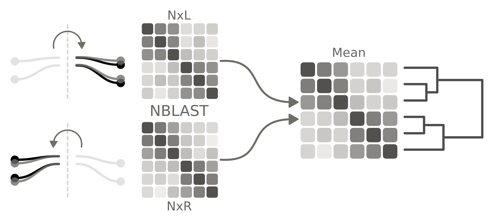

# Neuron Types of the First-Instar Drosophila Brain

This repository accompanies Section 4 of the first-instar (L1) *Drosophila* connectome.

## Aim

A neuroblast lineage is a developmental module. Its neurons share an origin, and their neurites occupy a common projection envelope (with some caveats). Sister neurons inside that envelope differ in shape and occupy different positions. Thus, the classification of neurons uses three nested units:

- The neuron class, differentiated neurons that share the same primary neuropil domains
- The neuron type, an anatomically coherent bilateral cluster within a class
- The neuron instance, the best-matching left-right pair within a type that has more than one neuron per hemisphere

Lineage labels and cytological categories are assigned in `L1_Skeletons`. NBLAST scoring matrices are computed in `L1_EM-Transforms`. This repository clusters the differentiated neurons, the small undifferentiated neurons, and the sensory bundles, writes a structural identifier for each differentiated neuron, builds a compartment map for each class, and draws the class and type counts.

The assignment used from this point on is `L1_NeuronInformation_PK.csv` in `L1_Skeletons`.

## Guide to the Repository

| Item | Path |
| --- | --- |
| Figure 4 | `Notebooks/Figure_04_Cluster-Statistics.ipynb`, `Figures/Figure_04_Panels-Cluster-Acronym-Stats.pdf` |
| Lineage counts | `Analysis_Outputs/L1_Lineage-Cluster-Acronym_Counts.csv` |
| Differentiated atlas | `Analysis_Outputs/Neuron_Clusters_Diff/Lineages/`, `ClusterInfo_12_2026-05-08_13-15-15.parquet` |
| 3D views | `Analysis_Outputs/Neuron_Clusters_Diff/3D_View/` |
| Compartment maps | `Data_Innervation/LineageAcronymCompartments_level1.parquet` |
| Identifiers | `Analysis_Outputs/Nomenclature/Split_Nomenclature_Identifiers_level1_100.csv`, `Split_Nomenclature_Identifiers_level2_100.csv` |
| SU atlas | `Analysis_Outputs/Neuron_Clusters_SU/Lineages/`, `ClusterInfo_12_2026-05-01_16-49-48.parquet` |
| Sensory atlas | `Analysis_Outputs/Neuron_Clusters_Sensory/Lineages/`, `ClusterInfo_12_2026-05-04_17-02-20.parquet` |
| Bilateral matches | `Analysis_Outputs/Hemisphere_Matching/ClusterInfo_12_2026-05-04_18-23-59.parquet`, `Analysis_Outputs/Hemisphere_Matching/Lineages/` |


The `S-GLN` and `S-AN` meshes in `L1_Lineages/Analysis_Outputs/Volumes/Sensory_Bundles/` are cut out of each sensory skeleton before NBLAST. The sensory table is `ClusterInfo_12_2026-05-04_17-02-20.parquet`. Two earlier runs from the same day sit beside it. `Analysis_Outputs/Nomenclature/2025-09-11/` is the identifier archive placed in CATMAID. The `*_ORG.csv` files in `Data_Innervation/` are earlier copies of the compartment maps.

## Classification Measures

| Column | Definition |
| --- | --- |
| `Lineage` | Lineage group |
| `Category` | `Diff`, `SU`, `Dev`, `suNB` |
| `Cluster`, `prat_cluster` | Morphological type |
| `Acronym` | Class label, `*` contralateral |
| `VolkerClass` | `Lineage_Acronym` |
| `Instance` | Left-right pair letter |
| `Count` | Types or classes in the lineage |
| `Hierarchy` | `Diff-Type`, `Diff-Class`, `SU-Type` |
| `Prat_Identifier` | `dendrite-\|-axon`; `.s` input, `.b` output, `*` contralateral |

## NBLAST

Differentiated neurons, SU neurons, and the sensory bundles are clustered using paired mirrored neuron sets. `NxL` is the set of left-hemisphere neurons plus the right-hemisphere neurons mirrored to left-hemisphere (see `L1_EM-Transforms`). `NxR` is the set of right-hemisphere neurons plus the left-hemisphere neurons mirrored to right-hemisphere. NBLAST is run all-to-all inside each set. The two distance matrices are averaged, and the mean is used for clustering.



## Bubble Diagram

Each differentiated-lineage figure draws one bubble diagram for the right hemisphere. Nodes are Level 1 compartments, placed from `Data_Innervation/NodeBubble.pkl`, with area set by mesh volume. An edge is a class connection, colored by that class. Width is $\sqrt{w^{*}}$. The diagram keeps the 50 largest weights. A solid edge represents connections from dendrite to axon (or from dendrite to dendrite). A dashed edge represents axo-axonic connections.

For class $a$, source compartment $s$, and target compartment $t$,

$r_{\mathrm{PSD}}(s) = \mathrm{Source\_PSDs}(s) / \mathrm{PSDs}_{a}$

$r_{\mathrm{TBar}}(t) = \mathrm{Target\_TBars}(t) / \mathrm{TBars}_{a}$

$w(s \rightarrow t) = r_{\mathrm{PSD}}(s)\, r_{\mathrm{TBar}}(t)$

$\mathrm{Scale}_{a} = C_{a} / C_{\ell}$

$w^{*}(s \rightarrow t) = w(s \rightarrow t)\, \mathrm{Scale}_{a}$

$C_{a}$ is the connectors of the class, and $C_{\ell}$ is the connectors of that lineage and hemisphere.

| Term | Column | Meaning |
| --- | --- | --- |
| $r_{\mathrm{PSD}}(s)$ | `Ratio_PSDs` | Class input in $s$ |
| $r_{\mathrm{TBar}}(t)$ | `Ratio_TBars` | Class output in $t$ |
| $w(s \rightarrow t)$ | `Connection_Weight` | $r_{\mathrm{PSD}}(s)\, r_{\mathrm{TBar}}(t)$ |
| $\mathrm{Scale}_{a}$ | `Scale` | Class share of the lineage |
| $w^{*}$ | `Scaled_Weight` | $w\, \mathrm{Scale}_{a}$ |

## Analysis Pipeline

Lineage labels, skeletons, and `L1_NeuronInformation_PK.csv` come from `L1_Skeletons`. NBLAST scoring matrices come from `L1_EM-Transforms`. Compartment meshes come from `L1_Compartment-Atlas`. `PROJECTS_HOME` points at the directory that contains `L1_Neuron-Typing`, `L1_Skeletons`, `L1_EM-Transforms`, `L1_Compartment-Atlas`, and `L1_Lineages`. The differentiated figures read the compartment maps in `Data_Innervation/` and the linkage files in `Analysis_Outputs/`. The count notebook reads the neuron table. `identifiers_split.py` and `upload_neuron_info.py` open a CATMAID session through pymaid.

**Identifiers.** `Scripts/identifiers_split.py` fetches differentiated skeletons from the L1 CATMAID volume through pymaid and splits each neuron into axon and dendrite. Each piece is named by the compartments it innervates, and the two pieces are joined as `dendrite-|-axon`. Class acronyms on the assignment are the Level 2 descriptors. Run it from the repository root, once with `--level level1` and once with `--level level2`. Each run writes an identifier table and a fragment table under `Analysis_Outputs/Nomenclature/`.

```
python Scripts/identifiers_split.py --level level1
```

**Synapses.** `Scripts/organize_synapses.py` reads those fragment tables and the neuron table. It totals connectors by neuron, by acronym, and by lineage, once with axon and dendrite kept separate and once summed. It writes six parquets for Level 1 and six for Level 2 under `Analysis_Outputs/Synapses/`. Run it from the repository root.

```
python Scripts/organize_synapses.py
```

**Compartment maps.** `Scripts/compartment_maps.py` reads the Level 1 acronym parquets and builds a source-by-target compartment map for each lineage, hemisphere, and acronym. It writes `Data_Innervation/LineageAcronymCompartments_level1.parquet` and `LineageAcronymCompartments_Pieces_level1.parquet`. Run it from the repository root.

```
python Scripts/compartment_maps.py
```

**Differentiated neurons.** `Scripts/nblast_clusters_diff.py` clusters the differentiated neurons of each lineage in `L1_Annotations-Lineages_PK.npy`. It reads the linkage cache in `Analysis_Outputs/Neuron_Clusters_Diff/Linkage/` and the compartment maps, and writes a PDF per lineage under `Lineages/`. The committed cluster table is `ClusterInfo_12_2026-05-08_13-15-15.parquet`, and that run wrote the HTML views in `3D_View/`. DPLc2 has no differentiated skeletons and is skipped. Run the script from the repository root.

```
python Scripts/nblast_clusters_diff.py
```

**Hemisphere matching.** `Scripts/hemisphere_matching.py` pairs left and right differentiated neurons independently of the type labels. It averages the two mirror directions of the NBLAST score and selects a one-to-one match. Matches are written to `Analysis_Outputs/Hemisphere_Matching/ClusterInfo_12_2026-05-04_18-23-59.parquet`, score matrices to `Matrices/`, and heatmaps to `Lineages/`. DPLc2 has no differentiated skeletons, and DPMl3/4a yields an empty distance matrix. Both are recorded in `Errors.txt`. Run the script from the repository root.

```
python Scripts/hemisphere_matching.py
```

**SU neurons.** `Scripts/nblast_clusters_su.py` clusters the SU neurons of each lineage that has SU skeletons. It reads `Analysis_Outputs/Neuron_Clusters_SU/Linkage/`, writes a PDF under `Lineages/`, and appends rows to `ClusterInfo_12_2026-05-01_16-49-48.parquet`. The committed run also wrote `3D_View/`. Run the script from the repository root.

```
python Scripts/nblast_clusters_su.py
```

**Sensory bundles.** `Scripts/nblast_clusters_sensory.py` clusters annotations whose names begin with `S-`, excluding `S-AN`. `BolwigsAxon` is not in that set. Before NBLAST it cuts the `S-GLN` and `S-AN` meshes in `L1_Lineages/Analysis_Outputs/Volumes/Sensory_Bundles/` out of each skeleton. It writes `ClusterInfo_12_2026-05-04_17-02-20.parquet` and the PDFs in `Analysis_Outputs/Neuron_Clusters_Sensory/Lineages/`. Run the script from the repository root.

```
python Scripts/nblast_clusters_sensory.py
```

**Annotation upload.** `Scripts/upload_neuron_info.py` reads the CSV named in the script and writes one CATMAID annotation per value through pymaid, then tags those annotations with a meta-annotation. As configured, it reads `Analysis_Outputs/L1_NeuronInformation_PK.csv` and uploads `ConnectivityGroup` under the meta-annotation `PK_ConnectivityGroup`. Run it from the repository root.

```
python Scripts/upload_neuron_info.py
```

**Figures.** `Notebooks/Figure_04_Cluster-Statistics.ipynb` is run from `Notebooks/`. It reads `L1_NeuronInformation_PK.csv`, keeps neurons that have a cluster, and excludes lineages whose names contain `S-`, `BolwigsAxon`, or `Unbound`. It writes `Analysis_Outputs/L1_Lineage-Cluster-Acronym_Counts.csv`, `Figures/Figure_04_Panels-Cluster-Acronym-Stats.pdf`, and `Figures/Figure_04_Supplementary_01-Cluster-Acronym-Counts.pdf`.

## Requirements

Tables and figures use pandas, NumPy, matplotlib, seaborn, Plotly, and SciPy. Parquet files are written with PyArrow. Skeleton geometry, NBLAST, and brain transforms use navis and flybrains. Linkage caches use h5py. Compartment graphs use networkx. Panel labels use `place_panel_label` from `prats_helpers`. CATMAID access and STL import use pymaid and `connectome_analysis_claude`.

`PROJECTS_HOME` is required. The checkout is expected at `$PROJECTS_HOME/L1_Neuron-Typing`. External inputs are:

- `$PROJECTS_HOME/L1_Skeletons` (the neuron table, the annotation lists, and the SWC collections)
- `$PROJECTS_HOME/L1_EM-Transforms` (the NBLAST scoring matrix)
- `$PROJECTS_HOME/L1_Compartment-Atlas` (compartment meshes and the level lists)
- `$PROJECTS_HOME/L1_Lineages` (the sensory-bundle meshes cut out before sensory NBLAST)

The code is released under the GNU General Public License, version 3.

## Repository Layout

```
L1_Neuron-Typing/
  Scripts/            # Identifiers, synapses, compartment maps, clustering, hemisphere matching, and upload; shared helpers in viz/
  Notebooks/          # Figure 4 class and type statistics
  Figures/            # Panels B-E and the supplementary lineage bars
  Data_Innervation/   # Compartment maps and the bubble-map layout
  Analysis_Outputs/   # Counts table, Nomenclature, Synapses, Neuron_Clusters_Diff, Neuron_Clusters_SU, Neuron_Clusters_Sensory, and Hemisphere_Matching
  LICENSE             # GNU GPL v3
```